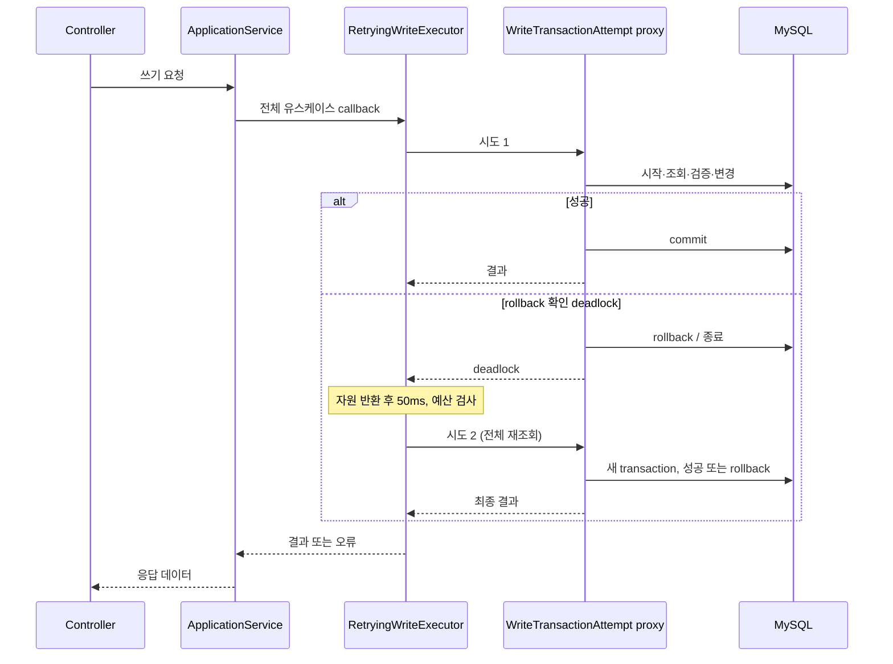

> 전체 코드 리뷰 항목 수정 요청으로 [review-fixes.md](review-fixes.md)의 보완 설계를 적용한다.
> 좋아요 쓰기 2개가 공통 보호 대상에 추가되어 총 10개이며, 조회 projection 컬럼·인덱스,
> 일괄 삭제 저장과 application 읽기 transaction·Example 책임 이동은 기존 본문의 해당 결정을 확장한다.

# 3주차 Backend 상세 설계

## 1. 문서 목적과 상태

- 기준 코드: `928d17dd5608fb157b4c9f22a7d1d472ff508514`. 운영 코드와 테스트를 구현하고 실제 MySQL 검증을 완료했다.
  실행 결과는 [검증 기록](verification-report.md)을 따른다.
- Facts: [작업 계획](implementation-plan.md)의 W3-01~13과 사용자 추가 결정을 구현 가능한 계약으로 구체화한다.
- Verified: 기존 Controller/DTO, domain repository, JPA 저장 구현과 설정을 읽었다. 이후 실제 MySQL 8.0 fixture에서 검증했으며 운영 DB는 변경하지 않았다.
- Decisions: 비관적 잠금, 작업별 저장, User·PointAccount 동시 생성/누락 보정, 브랜드 등록·삭제 공통 보호,
  domain 행동 기반 일괄 삭제, 보호하는 쓰기 유스케이스의 deadlock 1회 재시도, 503 구분을 적용한다.
- Unknowns: 구현을 막는 제품 정책은 없다. 아래 기술 설정은 설계 기준값이며 성능 측정 결과가 아니다.
- Constraints: Technical Writing Quest, 새 회원가입 API, 외부 PG, 요청키·성공 응답 재사용, 운영 migration,
  bulk 최적화, 무관한 리팩터링은 제외한다. 기존 API의 입력·성공 응답과 권한을 유지한다.

문서 간 역할은 [정책 결정](design-discussion.md), [오류 분류](transaction-error-policy.md),
이 문서의 저장/잠금/시간/API 계약으로 나눈다. 같은 계약이 다르면 구현 전에 문서를 일치시킨다.

## 2. 확정된 정책과 설정 출처

### 2.1 사용자 결정

- 잠금을 적용하는 쓰기 유스케이스에 전체 rollback 확인 deadlock 최대 1회 재시도를 공통 적용한다.
- 재시도 대기는 고정 **50ms**다. 직전 논의의 재시도 간격 예시를 선택한 것으로 해석하며
  jitter를 추가하지 않는다. 50ms를 DB 잠금 대기 제한이나 HTTP 전체 제한으로 해석하지 않는다.
- 잠금은 필요한 곳에만 적용한다. 일반 조회와 단순 지정값 갱신에 선행 FOR UPDATE를 일괄 추가하지 않는다.
- 저장 계약은 변경할 필드와 결과 판정을 명시한다. 무관한 필드를 덮어쓰지 않는다.
- 보정은 별도 전환 작업이며 요청 중 누락 계정을 자동 생성하지 않는다.

### 2.2 기술 설계 기준값

| 설정 | 값 | 근거·적용 위치 |
|---|---|---|
| 최대 시도 | 2회(최초 1 + 재시도 1) | 사용자 결정 |
| 재시도 간격 | 고정 50ms | 사용자 결정, transaction과 connection 반환 후 대기 |
| InnoDB 행 잠금 대기 | 2초 | 설계 기준값, commerce-api local/test pool의 connection-init-sql로 SESSION 설정 |
| 시도별 transaction timeout | 5초 | 설계 기준값, 실제 DB/driver에서 적용 검증 |
| 재시도 진입 예산 | 유스케이스 진입부터 15초 | 설계 기준값, monotonic clock으로 다음 시도 시작 가능 여부 판단 |
| connection 획득 대기 | 기존 3초 유지 | 현재 jpa.yml의 Hikari connection-timeout |
| 테스트 future/장벽 | 기본 30초/10초 | 설계 기준값, finally 정리. 업무 실패로 집계하지 않음 |

재시도 진입 시 남은 예산이 `50ms + connection 획득 3초 + transaction 5초`보다 작으면
추가 시도를 시작하지 않고 확인된 잠금 실패로 종료한다. 대기 후에도 한 번 더 확인한다.
이 예산은 재시도 진입 제어다. rollback·commit 응답 유실이나 네트워크 장애까지 포함한
엄격한 HTTP 15초 종료 보장을 뜻하지 않는다. 성공 commit을 단순한 경과 시간 초과 때문에
실패로 뒤집지 않는다. transaction 시간 초과는 원인과 rollback을 확인하여 기존 500으로
분류하고, 확인된 잠금 timeout만 503으로 매핑한다.

MySQL의 innodb_lock_wait_timeout은 초 단위이며 최소 1이다. 50ms를 이 설정에 넣지 않는다.
전역 DB 설정을 변경하지 않고 해당 애플리케이션의 local/test connection 설정에서 제어한다.
[MySQL 설정 근거](https://dev.mysql.com/doc/refman/8.0/en/innodb-parameters.html#sysvar_innodb_lock_wait_timeout)

## 3. 저장 및 트랜잭션

### 3.1 application 경계와 공통 재시도

공통 `RetryingWriteExecutor`(application)가 `WriteTransactionAttempt` Spring bean의
transactional public 메서드를 프록시로 호출한다. 한 번의 callback이 유스케이스 전체다.
`WriteTransactionAttempt`는 REQUIRED와 5초 timeout을 사용한다. 기존 쓰기 메서드에서
바깥 transaction을 먼저 시작하지 않도록 경계를 옮기며, executor 진입 시 이미 활성 transaction이
있으면 잘못된 호출로 거절한다. 저장별 REQUIRES_NEW나 실패한 transaction 안의 재시도는 없다.



repository 조회·domain 객체 생성·계산은 모두 callback 안에서 다시 실행한다. 첫 시도의
domain 객체·생성 ID·변경 결과를 재사용하지 않는다. 명시적 잠금 및 상태 조건 UPDATE로
보호하는 기존 8개와 리뷰 보완에서 추가한 좋아요 등록·취소 2개가 공통 대상이다. 일반 조회, DRAFT 생성, 브랜드 생성,
내부 사용자 초기화와 데이터 보정에는 일괄 retry annotation을 붙이지 않는다.
리뷰 보완에서 좋아요 등록·취소도 공통 executor에 연결한다.
새 적용 대상은 보호할 불변식과 DB 외부 부작용 유무를 근거로 추가한다.

원 요청 성공/업무 거절/기술 실패와 내부 attempt별 deadlock/timeout을 각각 기록한다.
rollback 실패·commit 결과 불명·업무 거절은 자동 재시도하지 않는다.

### 3.2 domain repository의 변경 계약

메서드명은 다음을 기준으로 한다. annotation/JPA 타입은 infrastructure 내부에 둔다.
조회 목록·페이지 계약은 유지한다. 아래 반환 null은 활성 행 부재이며 HTTP 매핑은 application/interfaces가 맡는다.

| 저장소 | 계약 | 의미 |
|---|---|---|
| BrandRepository | `create(brand): Brand` | 신규 insert만 수행 |
| BrandRepository | `findActiveForUpdate(id): Brand?` | 브랜드 삭제·상품 등록의 공통 잠금 조회 |
| BrandRepository | `updateName(brand): Brand?` | 활성 행의 이름만 저장, 결과 현재값 반환 |
| BrandRepository | `markDeleted(brand): Unit` | 잠근 브랜드의 삭제 상태만 저장 |
| ProductRepository | `create(product): Product` | 신규 insert, 이미 보호한 활성 Brand 참조 |
| ProductRepository | `findActiveForUpdate(id): Product?` | 주문 재고 검증·차감에 사용 |
| ProductRepository | `findActiveIdsByBrandId(brandId): List<Long>` | 브랜드 잠금 뒤 최초 일반 조회, 활성 상품 ID 오름차순 |
| ProductRepository | `updateDetails(product): Product?` | 활성 행의 이름·가격만 저장 |
| ProductRepository | `setStock(product): Product?` | 활성 행의 지정 최종 재고만 저장 |
| ProductRepository | `saveStockChanges(products): Unit` | 이미 잠근 ID순 상품의 domain 차감 결과만 저장 |
| ProductRepository | `markDeleted(product): Boolean` | 활성 행의 삭제 시각만 저장, 성공 여부 반환 |
| OrderRepository | `create(order): Order` | DRAFT와 품목 snapshot 신규 저장 |
| OrderRepository | `findForUpdate(id): Order?` | 본인·DRAFT 검사를 보호 |
| OrderRepository | `saveConfirmation(order): Order` | 상태·결제액·결과·확정 시각만 저장 |
| PointAccountRepository | `create(account): PointAccount` | 신규 초기화만, 중복을 upsert로 덮지 않음 |
| PointAccountRepository | `findByUserIdForUpdate(id): PointAccount?` | 충전·결제의 공통 잠금 |
| PointAccountRepository | `saveBalance(account): PointAccount` | 존재하는 계정 잔액 갱신만, 없으면 무결성 오류 |

변경 계약별 중립 저장 DTO를 `*EntityRepository`에 연결한다. 쓰기에 필요하지 않은 stock,
price, deletedAt 등을 DTO에 함께 넣지 않는다. 생성용 전체 DTO와 갱신용 DTO를 구분한다.
공통 save를 통해 변경 책임을 다시 우회하지 않도록 기존 호출부와 테스트 fixture를 함께 바꾼다.

### 3.3 부분 저장의 SQL·JPA 규칙

- domain의 `changeDetails`, `adjustStock`, `decreaseStock`, `delete`, `pay`, `charge`, `confirm`
  행동을 먼저 수행한다. SQL에 이름·가격·수량 계산 규칙을 복제하지 않는다.
- 기존 행의 저장은 PK 한 건 또는 이미 ID순으로 잠근 행별 명시적 컬럼 UPDATE로 구현한다.
  수정·삭제·재고 설정에는 `WHERE id=:id AND deleted_at IS NULL` 조건을 둔다.
- 단순 지정값 변경은 이 조건과 UPDATE의 쓰기 잠금으로 삭제와 순서를 정한다.
  이는 재고의 `stock=stock-quantity` 조건부 차감 전략을 도입한다는 뜻이 아니다.
- domain 삭제 행동을 각 상품에 호출하고 각 ID의 삭제 필드만 저장한다. 브랜드 전체를 한 문장으로
  삭제해 domain 행동을 생략하지 않는다. JDBC batch 사용 여부와 관계없이 commit은 한 번이다.
- native/JPQL 단건 UPDATE는 callback에 의존하지 않고 updated_at을 명시적으로 다룬다.
  created_at, brand_id, 주문 품목은 변경하지 않는다. 동일 값 요청은 성공하며 실제 값이
  바뀔 때만 updated_at을 갱신하는 기존 의미를 유지한다.
- 영향 행 수는 matched rows 기준(`useAffectedRows=false`)으로 명시하고 실제 driver로 검증한다.
  동일 값 설정의 변경 행 수 0을 없는 상품으로 오인하지 않는다.
- adapter는 필요한 변경을 먼저 flush한 뒤 단건 UPDATE를 수행한다. 읽었던 관리 객체는 수정하지
  않으며 UPDATE 후 해당 객체만 refresh하거나 현재값 projection으로 결과를 매핑한다.
  전체 clear로 미반영 변경을 버리거나 stale 객체를 나중에 save하지 않는다.
- refresh는 UPDATE가 잠근 동일 행에 대해 수행한다. 응답에는 명령 전 domain snapshot의
  다른 필드를 재사용하지 않는다. 여러 상품 저장은 품목마다 flush하지 않고 기존 회귀 조건을 유지한다.

[Connector/J matched rows 설정](https://dev.mysql.com/doc/connector-j/en/connector-j-connp-props-connection.html)

## 4. 동시성 및 무결성

### 4.1 명시적 잠금 순서

전체 상대 순서는 **Order → PointAccount → Brand → Product ID 오름차순**이다.
사용하지 않는 자원에는 잠금을 추가하지 않는다. 일반 조회는 잠금 조회로 바꾸지 않는다.

| 유스케이스 | 명시적 선행 잠금 | 이유 / DML 보호 |
|---|---|---|
| 주문 확정 | Order → PointAccount → 각 Product ID순 | 상태·잔액·재고의 읽기/검사/계산/변경 보호 |
| 포인트 충전 | PointAccount | 기존 잔액 + 충전액의 갱신 유실 방지 |
| 브랜드 일괄 삭제 | Brand → 각 활성 Product ID순 | 등록 차단 및 변경할 상품의 현재 상태 확보 |
| 상품 등록 | Brand | 활성 검증부터 insert commit까지 삭제와 조정 |
| 상품 이름·가격 수정 | 없음 | domain 값 검증 + 활성 조건 단건 부분 UPDATE |
| 관리자 최종 재고 설정 | 없음 | 증감이 아닌 지정값. 활성 조건 단건 stock UPDATE가 주문의 행 잠금과 경합 |
| 상품 개별 삭제 | 없음 | domain 삭제 행동 + 활성 조건 단건 삭제 UPDATE |
| 브랜드 이름 수정 | 없음 | 활성 조건 단건 name UPDATE |

표의 '없음'은 DB 쓰기 잠금이 없다는 뜻이 아니다. 불필요한 SELECT FOR UPDATE를 추가하지
않는다는 뜻이며, 이들 상태 조건 UPDATE도 공통 재시도 대상에 포함한다.

- 주문의 PK를 먼저 잠그고 소유자·DRAFT를 검증한다. PointAccount 부재는 무결성 오류다.
  상품은 PK별 잠금 조회를 ID순으로 실행한다. 다건 IN의 인자 순서에 잠금 순서를 맡기지 않는다.
- 브랜드 삭제는 transaction에서 Brand 잠금이 첫 DB 조회가 되도록 한다. 잠금 획득 뒤 첫
  비잠금 조회로 활성 Product ID를 수집하면 선행 등록 commit이 대상에 포함된다. 이후 각 ID를
  현재 상태로 잠금 조회한다. 그 사이 개별 삭제된 상품은 건너뛰고, 나머지를 domain 삭제한다.
  등록은 같은 Brand 잠금을 얻어야 하므로 이 경계 동안 새 ID가 끼어들 수 없다.
- 상품 수정 응답의 브랜드 정보 조회에는 역순 FOR UPDATE를 추가하지 않는다.
- 고정 순서가 FK·인덱스의 모든 교착을 없앤다고 단정하지 않는다. SQL과 실제 테스트로 점검한다.
- 관리자 설정과 주문이 겹치면 잠금/UPDATE 획득 순서에 해당하는 직렬 결과를 허용한다.
  예: 초기 5, 최종값 10 설정과 1개 주문은 설정→주문이면 9, 주문→설정이면 10이다.

### 4.2 domain·저장 모델 경계

현재의 domain → 중립 저장 데이터 → JPA 매핑 분리를 유지한다. application은 domain
repository 계약을 호출하고, 부분 UPDATE나 lock annotation은 JPA adapter에서 수행한다.
HTTP 오류는 interfaces가 변환하며, 기술 실패 분류와 retry 경계는 application 책임으로 둔다.

## 5. DB 설계와 보정 순서

### 5.1 저장 구조

리뷰 보완에서 products.like_count와 정렬 인덱스를 추가한다. 신규 테이블·version 컬럼·FK는 추가하지 않는다.
기존 unique/check와 참조는 유지하며 상세 저장/전환 계약은 review-fixes.md를 따른다.
기존 테이블 정의 전체는 [2주차 DB 설계](../week2/commerce-design.md)를 따른다.

| 애플리케이션 값 | 저장 위치 | 타입/Null | 변경 의미 |
|---|---|---|---|
| PointAccount.userId | point_balances.user_id | BIGINT PK, NOT NULL | User별 계정 하나 |
| PointAccount.balance | point_balances.balance | BIGINT, NOT NULL, CHECK >= 0 | 정상 사용자 생성 시 0으로 명시적 초기화, DB default로 추정하지 않음 |
| Product.stock | products.stock | INT, NOT NULL, CHECK >= 0 | domain 차감 결과 또는 관리자 지정 최종값 |
| Product.name/price | products.name/price | VARCHAR(255)/BIGINT, NOT NULL | 정보 수정 계약만 변경 |
| Brand/Product.deletedAt | brands/products.deleted_at | 기존 시간 타입, nullable | null=활성, 삭제 시 domain이 정한 시각 |
| Order 확정 필드 | orders.status/payment_amount/payment_result/confirmed_at | 기존 타입/nullable 유지 | 확정 때만 기록, 실패 시 DRAFT와 null 유지 |

주문 품목·수량·단가·총액과 기존 좋아요 관계는 삭제로 제거하지 않는다.
포인트 계정의 user_id PK는 중복을 막지만 모든 User의 계정 존재는 생성 경계로 보장한다.

### 5.2 사용자 초기화와 누락 보정

- 내부 `UserInitializationService.create(name)` 한 transaction에서 User와 PointAccount를 생성한다.
  fixture도 이 경로 또는 동등한 공통 fixture를 사용한다. 새 HTTP API는 만들지 않는다.
- 초기화 실패는 두 생성 모두 rollback한다. 0원 주문에도 이미 존재하는 계정을 사용한다.
- 보정은 `docs/week3/sql/backfill-point-accounts.sql`로 구현 시 제공할 명시적 전환 스크립트로 한다.
  파일을 제공했으며 테스트 DB에서 재실행과 기존 잔액 보존을 검증했다. 애플리케이션 시작 시 매번 실행하지 않는다.
- 보정 순서: 쓰기 요청 정지 → 누락/기존 잔액 읽기 확인 → 하나의 transaction에서 누락 user_id만
  balance=0 insert → 누락 0·기존 잔액 불변 확인 → commit → 새 생성 경로가 적용된 버전으로 재개.
- 실행 도중 오류는 전체 rollback한다. 같은 보정을 다시 실행해도 기존 계정을 UPDATE하지 않는다.
  운영 환경 자동 migration은 범위 밖이다. commit 뒤 무조건 행을 삭제하는 복구는 하지 않는다.
- 정상 동작 중 계정 부재는 500과 내부 무결성 오류다. 요청 경로에서 자동 복구하지 않는다.

## 6. API 설계

변경 대상은 기존 API 9개(쓰기 8, 잔액 조회 1)이며 신규 API는 0개다.
정상 응답은 아래 기존 모델을 유지하고 새 503만 공통 envelope로 추가한다.

- 성공: `meta={result:SUCCESS,errorCode:null,message:null}`, `data`는 각 모델.
- 실패 모델: `meta={result:FAIL,errorCode:<code>,message:<message>}`, `data=null`.
- 실제 wire JSON은 기존 Jackson `NON_NULL` 정책을 유지하므로 null 필드가 생략된다.
  따라서 실패의 `data`, 성공의 null `errorCode/message`는 전송하지 않는다. 모델의 null 표기는 필드 전송 약속이 아니다.
- `TRANSACTION_BUSY` 메시지: `다른 요청을 처리 중입니다. 잠시 후 상태를 확인해 주세요.`
- Brand: `id:Long,name:String,createdAt:ZonedDateTime,updatedAt:ZonedDateTime`.
- Product: `id:Long,name:String,price:Long,stock:Int,brand:{id:Long,name:String},createdAt,updatedAt`.
- Point: `userId:Long,balance:Long`.
- Order: `id,userId:Long,status:DRAFT|CONFIRMED,items:[{productId:Long,quantity:Int,unitPrice:Long,lineAmount:Long}],
  totalAmount:Long,paymentAmount:Long?,paymentResult:SUCCESS?,createdAt,confirmedAt?`.
- 관리자 요청은 기존 ADMIN 식별·CSRF를 유지하며 일반/미식별은 403 ADMIN_FORBIDDEN이다.
- 고객 요청은 X-USER-ID 헤더를 유지한다. 누락 401, 형식 오류 400, 사용자 없음 404다.
- Body의 아래 필드는 모두 필수·non-null이며 부분 PATCH 의미를 추가하지 않는다.
  기존 숫자 타입/범위와 이름 정규화 검증을 유지한다.

### 브랜드 일괄 삭제

```http
DELETE /api-admin/v1/brands/{brandId}
```

- 개발 구분: 기존 변경
- Param: brandId: Long, 양수
- Query: 없음
- Body: 없음
- Response: 200 ApiResponse<Any>, data:null
- 역할: 브랜드와 연결 미삭제 상품을 함께 soft delete
- 사용 상황: 관리자 브랜드 삭제
- 기획서 연계: [직접 §2 브랜드 일괄 처리]
- 권한: ADMIN + CSRF
- 주요 오류: 404 BRAND_NOT_FOUND; 503 TRANSACTION_BUSY. 상세 입력 오류의 기존 envelope 유지.

#### 기존변경건

- **As-is**: 활성 상품 존재 시 409 BRAND_HAS_ACTIVE_PRODUCTS.
- **To-be**: 재고 0 포함 대상 전체 삭제, 다른 대상·주문 보존.
- **필요한 변경**: Brand 잠금과 대상 상품 ID순 잠금, domain 삭제·작업별 저장, 전체 transaction/retry.

### 상품 등록

```http
POST /api-admin/v1/products
```

- 개발 구분: 기존 변경
- Param: 없음
- Query: 없음
- Body: {brandId:Long,name:String,price:Long,stock:Int}; price/stock >= 0
- Response: 201 ApiResponse<Product>
- 역할: 활성 브랜드에 상품 생성
- 사용 상황: 관리자 상품 등록
- 기획서 연계: [지원 §2 및 사용자 선택 확장]
- 권한: ADMIN + CSRF
- 주요 오류: 404 BRAND_NOT_FOUND; 400 기존 입력 오류; 503 TRANSACTION_BUSY. 상세 입력 오류의 기존 envelope 유지.

#### 기존변경건

- **As-is**: 브랜드 활성 비잠금 조회 후 insert.
- **To-be**: 브랜드 삭제와 같은 Brand 잠금을 유지한 상태로 생성.
- **필요한 변경**: 상품 생성 transaction·공통 retry와 Brand 잠금 조회.

### 상품 정보 수정

```http
PUT /api-admin/v1/products/{productId}
```

- 개발 구분: 기존 변경
- Param: productId: Long, 양수
- Query: 없음
- Body: {name:String,price:Long}; price >= 0
- Response: 200 ApiResponse<Product>
- 역할: 상품 이름·가격 변경
- 사용 상황: 관리자 상품 편집
- 기획서 연계: [호환 §2 삭제 후 수정 거절 및 §3 우회 경로]
- 권한: ADMIN + CSRF
- 주요 오류: 404 PRODUCT_NOT_FOUND; 400 기존 입력 오류; 503 TRANSACTION_BUSY. 상세 입력 오류의 기존 envelope 유지.

#### 기존변경건

- **As-is**: 전체 domain 상태를 updateFrom으로 반영.
- **To-be**: 이름·가격만 활성 조건으로 저장, 재고·삭제 상태 보존.
- **필요한 변경**: domain changeDetails 후 단건 부분 UPDATE, 결과 refresh, 공통 retry.

### 관리자 최종 재고 설정

```http
PUT /api-admin/v1/products/{productId}/stock
```

- 개발 구분: 기존 변경
- Param: productId: Long, 양수
- Query: 없음
- Body: {stock:Int}; stock >= 0
- Response: 200 ApiResponse<Product>
- 역할: 상품의 최종 재고를 지정값으로 설정
- 사용 상황: 관리자 재고 변경
- 기획서 연계: [직접 §3 관리자 최종 수량 설정]
- 권한: ADMIN + CSRF
- 주요 오류: 404 PRODUCT_NOT_FOUND; 400 INVALID_STOCK/INVALID_REQUEST; 503 TRANSACTION_BUSY. 상세 입력 오류의 기존 envelope 유지.

#### 기존변경건

- **As-is**: 비잠금 조회 후 전체 상태 저장.
- **To-be**: 활성 조건 stock 전용 UPDATE, 주문의 행 잠금과 직렬화.
- **필요한 변경**: domain adjustStock 유지, 선행 잠금 없이 단건 UPDATE와 공통 retry.

### 상품 개별 삭제

```http
DELETE /api-admin/v1/products/{productId}
```

- 개발 구분: 기존 변경
- Param: productId: Long, 양수
- Query: 없음
- Body: 없음
- Response: 200 ApiResponse<Any>, data:null
- 역할: 상품을 soft delete
- 사용 상황: 관리자 상품 삭제
- 기획서 연계: [호환 §2 및 §3 기존 쓰기 경로]
- 권한: ADMIN + CSRF
- 주요 오류: 404 PRODUCT_NOT_FOUND; 503 TRANSACTION_BUSY. 상세 입력 오류의 기존 envelope 유지.

#### 기존변경건

- **As-is**: 전체 상품 상태를 저장해 삭제.
- **To-be**: 삭제 필드만 활성 조건으로 저장, 가격·재고·주문 보존.
- **필요한 변경**: domain delete 후 단건 부분 UPDATE와 공통 retry.

### 브랜드 이름 수정

```http
PUT /api-admin/v1/brands/{brandId}
```

- 개발 구분: 기존 변경
- Param: brandId: Long, 양수
- Query: 없음
- Body: {name:String}
- Response: 200 ApiResponse<Brand>
- 역할: 브랜드 이름 변경
- 사용 상황: 관리자 브랜드 편집
- 기획서 연계: [지원 §2 삭제 상태 덮어쓰기 방지]
- 권한: ADMIN + CSRF
- 주요 오류: 404 BRAND_NOT_FOUND; 400 INVALID_NAME/INVALID_REQUEST; 503 TRANSACTION_BUSY. 상세 입력 오류의 기존 envelope 유지.

#### 기존변경건

- **As-is**: 이름과 삭제 상태를 함께 저장.
- **To-be**: 이름만 활성 조건으로 저장.
- **필요한 변경**: 부분 UPDATE, 결과 refresh, 공통 retry.

### 최초 주문 확정

```http
POST /api/v1/orders/{orderId}/confirm
```

- 개발 구분: 기존 변경
- Param: orderId: Long, 양수
- Query: 없음
- Body: 없음
- Response: 200 ApiResponse<Order>
- 역할: 본인 DRAFT 주문의 재고·포인트 차감과 확정
- 사용 상황: 고객 주문 확정
- 기획서 연계: [직접 §3 포인트 주문·§4 경쟁 검증]
- 권한: X-USER-ID, 본인 주문
- 주요 오류: 403 ORDER_NOT_OWNED; 404 ORDER_NOT_FOUND/PRODUCT_NOT_FOUND; 409 ORDER_ALREADY_CONFIRMED/INSUFFICIENT_STOCK/INSUFFICIENT_POINTS; 503 TRANSACTION_BUSY; 500 계정 누락/결과 불명. 상세 입력 오류의 기존 envelope 유지.

#### 기존변경건

- **As-is**: transaction은 있으나 상태·잔액·재고에 잠금 없음.
- **To-be**: Order→PointAccount→Product ID순 보호, 확정 필드만 저장, deadlock 1회 재시도.
- **필요한 변경**: 기존 application transaction을 공통 executor 경계로 연결, 재조회·domain 검증·부분 저장.

### 포인트 충전

```http
POST /api/v1/points/charge
```

- 개발 구분: 기존 변경
- Param: 없음
- Query: 없음
- Body: {amount:Long}; 양수 정수, overflow 거절
- Response: 200 ApiResponse<Point>
- 역할: 기존 포인트 계정에 충전
- 사용 상황: 고객 충전
- 기획서 연계: [직접 §3 충전·결제 보호]
- 권한: X-USER-ID 본인
- 주요 오류: 400 INVALID_REQUEST; 409 POINT_BALANCE_OVERFLOW; 503 TRANSACTION_BUSY; 500 계정 누락/결과 불명. 상세 입력 오류의 기존 envelope 유지.

#### 기존변경건

- **As-is**: 계정 부재 시 생성, 잔액 조회·변경 전체의 transaction 없음.
- **To-be**: 존재하는 PointAccount 잠금 후 charge, 잔액만 저장.
- **필요한 변경**: 지연 생성 제거, 공통 transaction/retry 경계, 포인트 잠금 조회.

### 포인트 잔액 조회

```http
GET /api/v1/points
```

- 개발 구분: 기존 변경
- Param: 없음
- Query: 없음
- Body: 없음
- Response: 200 ApiResponse<Point>
- 역할: 저장된 본인 잔액 조회
- 사용 상황: 고객 잔액 확인
- 기획서 연계: [지원 사용자 결정 D2 계정 존재 불변식]
- 권한: X-USER-ID 본인
- 주요 오류: 기존 사용자 식별 오류; 500 계정 누락. 상세 입력 오류의 기존 envelope 유지.

#### 기존변경건

- **As-is**: 계정 부재를 잔액 0으로 반환.
- **To-be**: 정상 계정 조회, 부재는 무결성 오류.
- **필요한 변경**: 0 fallback 제거, 일반 조회 유지, FOR UPDATE/retry 추가 없음.

## 7. 테스트 계획

[작업 계획 T01~T14](implementation-plan.md)에 다음 상세 검증을 연결한다.

1. SQL 관찰: 일반 조회/정보 수정/최종 수량 설정/개별 삭제에는 사전 FOR UPDATE가 없고,
   보호가 필요한 주문·충전·브랜드 집합 경로에는 실제 잠금 SQL이 실행되는지 확인한다.
2. 부분 저장: 실제 UPDATE의 SET 컬럼 및 flush·clear 후 상태를 확인한다. 이름 수정과 주문,
   재고 설정과 주문, 삭제와 수정의 두 직렬 순서를 테스트하고 무관한 필드가 보존됨을 확인한다.
3. 동일 값 요청: 이름·가격·재고를 같은 값으로 다시 보내도 404가 되지 않고 정상 반환한다.
4. 현재값: 이름 수정 응답이 다른 요청의 재고 변경을 오래된 값으로 덮거나 오래된 관리 객체를
   반환하지 않도록 재조회 결과를 검증한다.
5. 공통 retry: 대상 10개 쓰기 유스케이스의 executor 연결을 application 테스트로 확인한다.
   실제 MySQL rollback·새 transaction 재조회는 주문/충전/브랜드 대표 경로로 검증한다.
6. 시간: fake clock/sleeper로 최초 시도에는 대기가 없고 retry 전 정확히 50ms를 요청하며,
   예산 부족/인터럽트에서 추가 시도를 하지 않음을 검증한다. 실제 transaction/connection이
   대기 중 보유되지 않는지 확인한다. 벽시계가 정확히 50ms에 깨어난다고 assertion하지 않는다.
7. MySQL 세션: pool에서 얻은 서로 다른 connection의 lock wait 설정이 2초인지 확인한다.
   실제 잠금 대기 timeout 뒤 앞 변경까지 rollback되고 503이며 재시도하지 않는지 확인한다.
8. 원자성/경쟁: 기존 필수 성공·거절 수치, 사용자·포인트 동시 생성 실패, 보정 재실행,
   브랜드 삭제/등록 양쪽 순서까지 실제 DB 최종 상태를 확인한다.
9. 재시도 집계: 원 요청 수와 내부 시도 수를 분리하며 성공 1건이 재시도 때문에 2건으로
   집계되지 않는다. 내부 deadlock 빈도를 숨기지 않는다.
10. ArchitectureTest: 실제 새 application executor/attempt 및 저장 경계가 검사 대상에 포함되고,
    JPA/HTTP 타입이 domain/application으로 유입되지 않음을 검사한다. 기존 규칙을 완화하지 않는다.

테스트 장벽·실패 주입은 테스트 저장 경계에만 둔다. 실제 서비스의 post-read 장벽은 없다.
재시도 대기 50ms는 제품의 복구 정책이며 테스트를 우연히 겹치게 하는 sleep과 구분한다.

## 8. 구현 불변식과 검증 상태

- 사용자 결정은 확정됐다. 위 메서드·SQL 방식·잠금 순서·설정값은 이를 구현하는 기술 설계다.
- 구현 결과가 이 계약을 깨뜨리면 코드 또는 설계 원인을 분석하고 기록한다. 과제의 성공 건수나
  기존 테스트 기대값을 편의상 낮추지 않는다. 정책 변경이 필요할 때만 사용자에게 다시 확인한다.
- 문서 구조·링크 검사는 문서 검증이다. 실제 DB/성능/rollback 검증을 대신하지 않는다.
- 현재 상태: 운영 코드·테스트 구현, 실제 MySQL 포함 111건·ktlint·ArchitectureTest·check 통과.
  실제 실행 건수·실패·skip은 [검증 기록](verification-report.md)을 따른다.
- 구현 시 `$codex-new-feature`로 시작하고 이 문서와 기존 작업 계획의 검사 명령을 따른다.

## 9. 구현에서 구체화한 기술 사항

다음은 제품 정책 변경이 아닌 확정 설계의 구현 선택이다. 실제 DB 효력은 아래 검증으로 확인했다.

- `AttemptState`가 Spring `afterCompletion`의 rollback 완료 상태와 callback 실패를 기록한다.
  프록시가 반환된 후에만 분류·대기한다. MySQL vendor code와 SQLState의 조합
  `1213/40001`, `1205/(HY000 또는 40001)`을 확인하고 연결 장애/TransactionSystemException은 재시도에서 제외한다.
- 부분 UPDATE는 먼저 flush한 뒤 `FlushModeType.COMMIT`으로 실행한다. 여러 상품 저장에서
  품목별 자동 flush가 누적되지 않게 한다. 업데이트된 동일 행만 PESSIMISTIC_WRITE refresh하여
  REPEATABLE READ의 이전 snapshot이나 managed 객체가 응답의 현재값을 가리지 않게 한다.
  단순 지정값 변경의 **선행** FOR UPDATE는 없다. refresh의 동일 행 현재 읽기는 UPDATE 뒤다.
- 이름 비교는 MySQL 기본 collation의 대소문자 무시가 timestamp 변경을 숨기지 않게 `binary` 비교를 쓴다.
  `updated_at` 조건을 SET의 앞에 두어 MySQL의 왼쪽부터 대입하는 의미에서 원래 필드값을 비교한다.
- 최초 생성은 insert 전용이며 PointAccount에는 `persist`를 사용해 중복 생성으로 잔액을 덮지 않는다.
- 요청 관측용 내부 UUID는 로그의 시도 연결 용도다. HTTP 요청키나 멱등성 계약이 아니다.

기술 근거: [Spring transaction completion 상태](https://docs.spring.io/spring-framework/docs/6.2.x/javadoc-api/org/springframework/transaction/support/TransactionSynchronization.html),
[MySQL rollback 범위](https://dev.mysql.com/doc/refman/8.0/en/innodb-error-handling.html).

### 보정 실행 절차

쓰기 중지 후 운영자가 같은 connection에서 `START TRANSACTION`을 실행하고 기존 계정·잔액과
누락 목록을 보관한다. [SQL](sql/backfill-point-accounts.sql)을 실행하고 누락 0 및 기존 잔액 불변을
조회로 확인한 다음 `COMMIT`한다. 실패하면 `ROLLBACK`한다. 스크립트 자체는 검증 전 임의 commit을
수행하지 않으며 요청 경로나 애플리케이션 시작에 연결하지 않는다. 테스트는 같은 SQL을
TransactionTemplate 안에서 두 번 실행하고 기존 잔액·계정 수·누락 수를 확인하도록 작성했다.

### 실제 MySQL/driver 검증으로 확인한 보완

- Connector/J 9.1.0은 MySQL 오류 1205의 SQLState를 서버의 HY000에서 **40001로 변환**한다.
  실제 첫 실행에서 timeout이 500으로 분류된 원인을 확인한 뒤 vendor code 1205와 두 알려진
  SQLState 조합만 허용했다. 40001 전체를 deadlock으로 보지 않으며 timeout에는 재시도하지 않는다.
  [Connector/J 9.1.0 매핑](https://github.com/mysql/mysql-connector-j/blob/9.1.0/src/main/core-api/java/com/mysql/cj/exceptions/MysqlErrorNumbers.java)
- HikariCP 5.1.0은 `SQLTimeoutException`을 connection 폐기 사유로 처리한다. 실제 `SLEEP(7)`은
  transaction의 5초 timeout으로 취소됐지만, 폐기된 connection에 대한 Spring rollback이 실패하여
  원래 QueryTimeoutException이 JpaSystemException으로 덮였다. executor는 원래 callback 실패를
  suppressed exception으로 보존한다. 이 경우 완료 상태를 UNKNOWN으로 기록하고 **500, 재시도 0회**를
  유지한다. 새 transaction의 잠금 조회로 앞 재고 변경이 남지 않았음도 확인한다. 임의의
  Hikari eviction 예외 설정으로 실패를 숨기지 않는다.
  [HikariCP 5.1.0 예외 처리](https://github.com/brettwooldridge/HikariCP/blob/HikariCP-5.1.0/src/main/java/com/zaxxer/hikari/pool/ProxyConnection.java)
- JdbcTemplate의 close-suppressing Connection 프록시는 닫힘을 직접 관찰하기에 적합하지 않다.
  테스트는 `ConnectionProxy.targetConnection`의 풀 connection을 기록하여 retry sleeper 진입 시
  `isClosed=true`와 Spring resource map 비어 있음을 검증한다. 운영 코드에 테스트 hook을 넣지 않는다.
- 위 내용은 제품 정책/외부 API 변경 없이 드라이버 예외·관측 경계를 구체화한 것이다.
